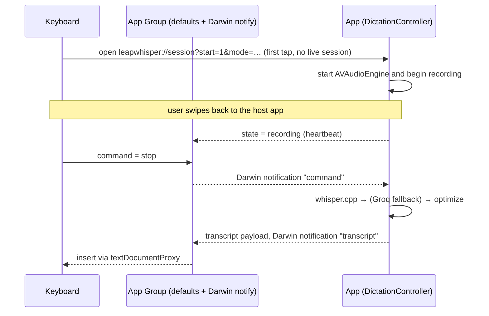
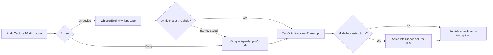

# Architecture

## Targets

| Target | Kind | Responsibility |
| --- | --- | --- |
| `LeapWhisper` | App | Microphone session, whisper.cpp inference, Groq client, optimization, history and stats, models, settings |
| `LeapKeyboard` | Keyboard extension | Mode chips, mic toggle, text insertion. No audio and no ML. |
| `LeapWidgets` | WidgetKit extension | Home Screen and Lock Screen widget, Control Center control, Live Activity |

Shared code in `Shared/` is compiled into all three targets: App Group storage, Darwin notifications, modes and the intent.

## Keyboard microphone constraint

iOS keyboard extensions can't record audio. The app owns the `AVAudioEngine` session and keeps it alive in the background with
the `audio` background mode. The keyboard drives it remotely:

After a dictation the engine stays on for the standby window (`MicStandby`: off, 5 minutes, 15 minutes by default, 1 hour or
always). While it's on, keyboard taps send `start`/`stop` through the App Group and no app switch happens; iOS shows the orange
mic indicator for the whole window. The keyboard's mic-off button sends `end` to stop the engine early. Once the engine has
stopped, iOS won't let the backgrounded app start the microphone again, so the next keyboard tap opens the app. With standby
off the engine stops after every dictation. See [ADR-0002](decisions/0002-keep-mic-ready-window.md).

If a `start` isn't picked up (the app died between two heartbeats, or the notification was lost), the keyboard re-posts the
notification twice and then, after 1.5 s, opens the app.

## Pipeline

## Storage

| Data | Location | Notes |
| --- | --- | --- |
| Settings, modes, state, commands, last transcript | App Group `UserDefaults` | Shared with the extensions |
| Groq API key | Keychain `com.leapwhisper.secrets` | The app only |
| Models | `Application Support/Models/*.bin` | Excluded from iCloud backup |
| History | `Application Support/history.json` | The app only, file protection on, last 2,000 entries |

## Key files

- Pure logic, unit-tested with `swift test`: `Shared/Core/` (`Package.swift` at the repo root, tests in `Tests/LeapCoreTests`)

- Orchestration: `App/DictationController.swift`
- Audio: `App/AudioCapture.swift`, `App/WAVEncoder.swift`
- Inference: `App/WhisperEngine.swift`, `Packages/WhisperFramework` (whisper.cpp v1.9.2 XCFramework)
- Cloud: `App/GroqClient.swift`
- IPC: `Shared/AppGroup.swift`, `Shared/SharedStore.swift`, `Shared/DarwinNotifier.swift`
- Keyboard: `Keyboard/KeyboardModel.swift`, `Keyboard/KeyboardView.swift`, `Keyboard/URLOpener.swift`
